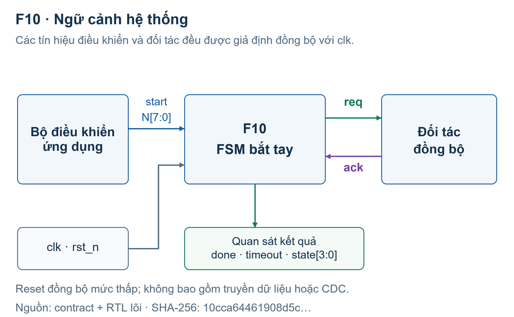
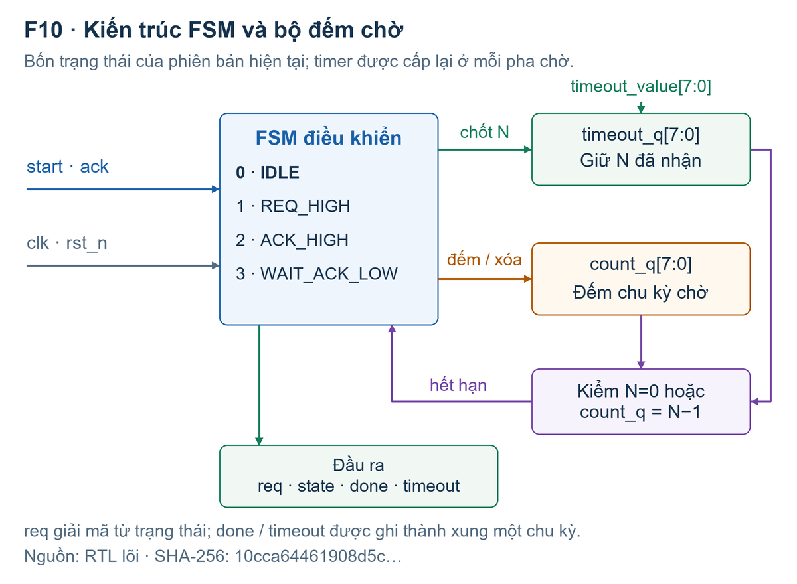
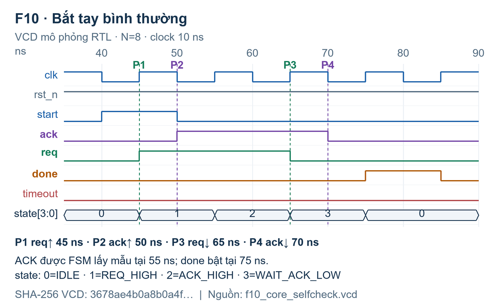
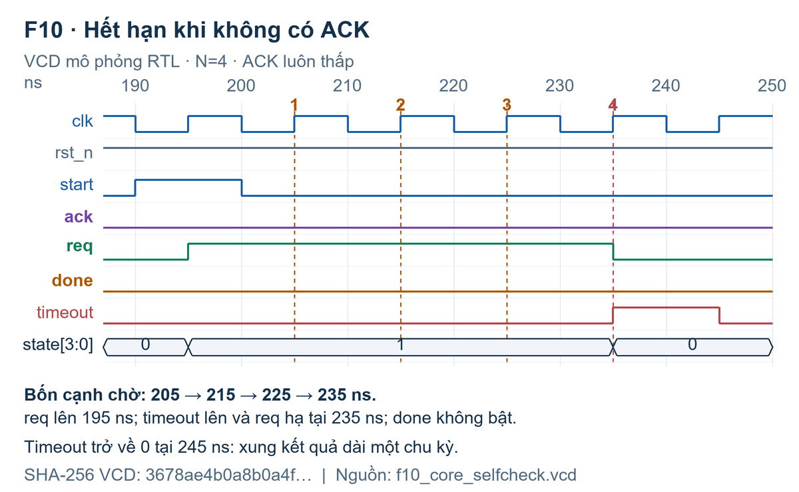
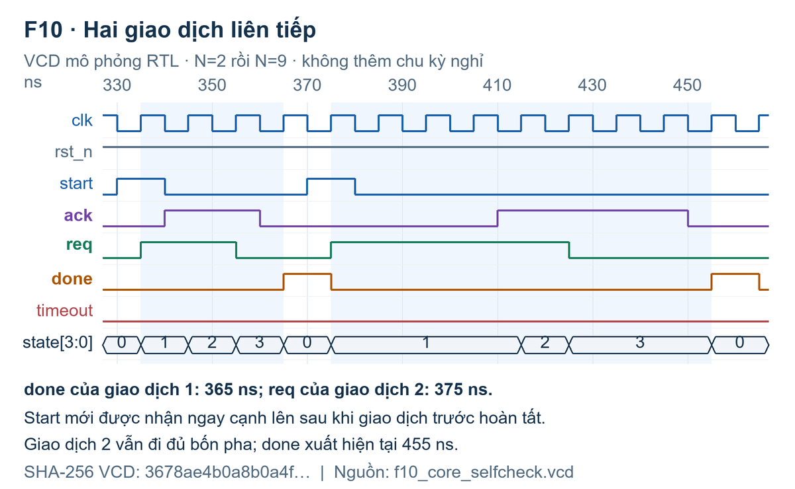
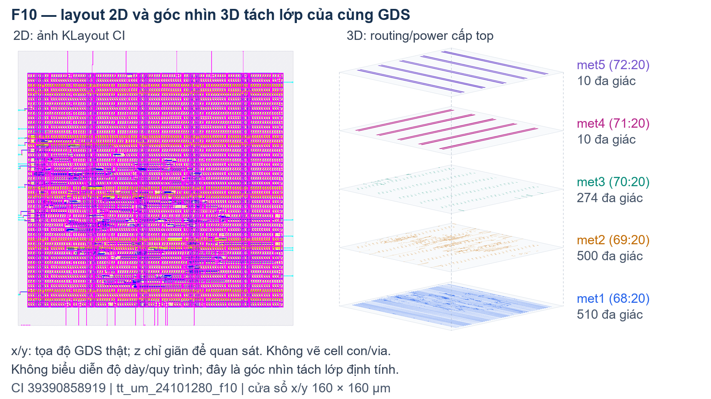
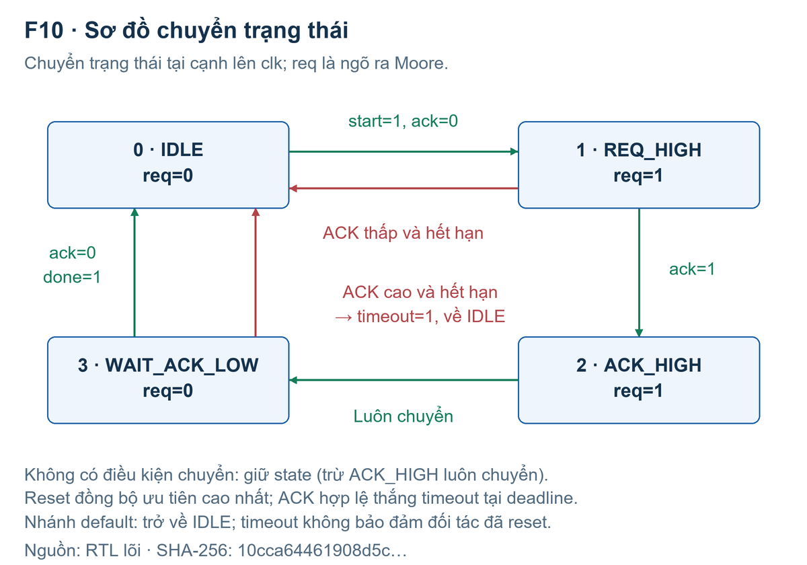

# F10 - Bản báo cáo làm việc

## BÁO CÁO BÀI KIỂM TRA SỐ 2

F10 FSM bắt tay bốn pha req/ack

TRƯỜNG ĐẠI HỌC PHENIKAA Nhập môn Thiết kế Vi mạch Tích hợp - EEE703128

| Thông tin | Nội dung |
| --- | --- |
| Sinh viên | Lê Chí Hoàng Cường |
| Mã số sinh viên | 24101280 |
| Lớp | Nhập môn thiết kế vi mạch tích hợp-1-1-26(N01) |
| Giảng viên hướng dẫn | Đinh Văn Nam |
| Ngày cập nhật | 20/10/2026 |
| Repo / commit / CI | GitHub: lechihoangcuong/eee703128-f10-24101280; mã chạy 298e12b; Actions run 39390858919. Link đầy đủ ở tr.15. |

<b>Trạng thái hồ sơ:</b> đã công bố repo có lịch sử thật và chạy GitHub Actions. Hai job mo-phong và rtl2gds thành công; artifacts đã được tải và đối chiếu hash. Báo cáo được cập nhật sau lần chạy, không thuộc chính commit thực thi đó.

CI xác nhận lõi 1.035 ca, wrapper 11 ca PASS; generic 22 flip-flop; LibreLane sinh GDS, DRC/LVS báo 0 lỗi. <b>Còn 11 vi phạm max slew ở góc SS</b>; SDC mặc định và giả định hoạt động công suất giới hạn ý nghĩa số liệu.

Bố cục: 1. Đặc tả (tr.2-3); 2. RTL (tr.4); 3. Kiểm chứng (tr.5-8); 4. Tổng hợp (tr.9); 5. Thời gian (tr.10); 6. Công suất, vật lý (tr.11); 7. Layout (tr.12); 8. Phân tích riêng (tr.13); 9. Kết luận (tr.14); tái lập và nguồn (tr.15).

## 1. Đặt vấn đề và đặc tả

Khi một khối cần yêu cầu khối khác xử lý, hai bên phải thống nhất thời điểm bắt đầu và kết thúc. F10 thực hiện bên phát yêu cầu: đưa req lên, chờ ack lên, hạ req, rồi chờ ack hạ. Chỉ sau bước cuối mới phát xung done.

Hình 1. Vị trí của F10 trong hệ thống. Đối tác đáp ứng được mô hình hóa trong testbench.

Phân loại và phạm vi

Đây là mạch số tuần tự: kết quả phụ thuộc đầu vào hiện tại và trạng thái đã lưu. Đếm chờ, giữ cấu hình và chuyển trạng thái đều dùng flip-flop. Logic so sánh, cộng và giải mã đầu ra là logic tổ hợp. Không có khối analog hoặc mixed-signal trong RTL này.

Thiết kế chỉ điều khiển giao thức, không truyền payload. Clock được chia sẻ; ack và start đồng bộ. Đối tác hợp lệ giữ ACK cao đến khi quan sát req thấp và chỉ xác nhận yêu cầu mới sau req mới. Đồng bộ clock tự nó chưa bảo đảm đúng thứ tự bốn pha. CDC, metastability, giao thức hai pha và truyền nhiều byte ngoài phạm vi.

Cách hiểu giao diện: lõi là requester, responder là đối tác bên ngoài. Nếu giảng viên muốn cả hai bên là RTL triển khai riêng, phải chốt lại phạm vi; hồ sơ này không nhận là đã triển khai một cặp requester/responder độc lập. [S1, S2]

## 1.1. Giao diện, reset và các giả định

| Tín hiệu / chân | Rộng, chiều | Mức / ý nghĩa |
| --- | --- | --- |
| clk | 1, vào | Cạnh lên cập nhật các thanh ghi |
| rst_n | 1, vào | Tích cực 0, reset đồng bộ tại cạnh lên |
| ena | 1, vào | Cho nhận start mới; không đóng băng giao dịch đang chạy |
| ui_in[7:0] | 8, vào | N không dấu 0..255; chốt khi nhận start |
| uio_in[0] | 1, vào | ack tích cực 1; theo charter |
| uio_in[1] | 1, vào | start tích cực 1; ánh xạ bổ sung được đề xuất |
| uo_out[0] | 1, ra | req tích cực 1 |
| uo_out[2:1] | 2, ra | [1]=done, [2]=timeout; xung một chu kỳ |
| uo_out[6:3] | 4, ra | state: 0,1,2,3 |
| uo_out[7] | 1, ra | Cố định 0 |
| uio_out / uio_oe | 8 / 8, ra | Đều 0; tất cả chân uio ở chế độ vào |

Start chỉ được nhận ở IDLE khi start=1 và ack=0. Start trong lúc bận không được xếp hàng. Start giữ mức 1 có thể khởi động tiếp khi trở về IDLE. Với wrapper, start nội bộ bằng ena AND uio_in[1].

ACK cũ đang cao khiến start bị từ chối. Thay N trong lúc bận không đổi thời hạn đã chốt. ACK đúng hạn thắng timeout; reset tại cạnh lên có ưu tiên cao nhất.

<b>Điểm cần giảng viên xem xét:</b> charter chưa gán chân start. Dùng uio_in[1] là phương án tích hợp từ chân trống, không phải phê duyệt đã có. Các chân charter giữ nguyên; dùng 10 bit vào và 7 bit ra, nằm trong ngân sách 24 chân.

## 2. Thiết kế RTL và quyết định kiến trúc

Hình 2. Cấu trúc RTL thực: FSM, ngưỡng đã chốt, bộ đếm chờ và giải mã đầu ra.

| Trạng thái | Điều kiện tại cạnh lên | Hành động / trạng thái tiếp |
| --- | --- | --- |
| IDLE (0) | start và ack=0 | Chốt N; count=0; sang REQ_HIGH |
| REQ_HIGH (1) | ack=1 / hết hạn | Sang ACK_HIGH / timeout rồi IDLE |
| ACK_HIGH (2) | Luôn luôn | Giữ đủ một chu kỳ; sang WAIT_ACK_LOW |
| WAIT_ACK_LOW (3) | ack=0 / hết hạn | done / timeout; trở về IDLE |

req là ngõ ra Moore, bằng 1 ở trạng thái 1 hoặc 2. done và timeout là hai ngõ ra được đăng ký, mặc định xóa ở mỗi cạnh lên. Bộ đếm được xóa trước mỗi pha chờ; hai pha có hai ngân sách N riêng.

Bốn pha là bốn cạnh tín hiệu, không bắt buộc mọi cách thiết kế phải có bốn trạng thái. Phiên bản nguồn dùng enum 4 bit và xuất mã state ra chân; không thay mã hóa để làm đẹp số cell. Lõi nguồn giữ nguyên, wrapper cũ buộc clock/reset/start bằng hằng được sửa ở lớp tích hợp. [S2]

## 3. Kiểm chứng chức năng: kế hoạch và kết quả

Expected được tính bởi mô hình đếm số chu kỳ còn lại, không đọc state nội bộ để đoán đáp án. Stimulus đổi ở cạnh xuống; model lấy mẫu ở cạnh lên, checker đọc sau 1 ns để chờ phép gán nonblocking hoàn tất. Clock mô phỏng là 10 ns, độ chính xác 1 ps.

| Nhóm ca | Mục đích / kỳ vọng | Kết quả |
| --- | --- | --- |
| Bình thường | Đủ bốn cạnh; done một chu kỳ | PASS |
| Đáp ứng chậm | ACK lên/xuống trễ nhưng trong N | PASS |
| Không có ACK, N=4 | Timeout ở cạnh chờ thứ 4; không done | PASS |
| Hai lần liên tiếp | Hai done riêng, nạp lại N=2 rồi N=9 | PASS |
| ACK mắc cao / ACK cũ | Timeout pha về; không nhận start cũ | PASS |
| Start bận / đổi N bận | Không chen giao dịch hoặc nạp lại N | PASS |
| Reset trong các trạng thái | Chỉ reset tại cạnh lên | PASS |
| 4 nhóm × 256 N | Hai timeout, hai ưu tiên ở deadline | 1.024 PASS |
| Stress seed F1002026 | 4.096 chu kỳ, có 16 reset | PASS |

Lõi: <b>1.035 ca, 138.571 chu kỳ được kiểm, 1.665.218 phép check, 0 lỗi</b>. Compile và simulator đều thoát 0. Log có câu ALL TESTS PASSED; CSV có 1.035 ID riêng biệt. Wrapper: <b>11 ca, 708 check, 0 lỗi</b>, gồm nối chân, ena, reset và đủ 8 bit cấu hình.

Số trên được xác nhận lại trong artifact CI mo-phong-F10, cùng kết quả local. “Check” là phép so sánh, không phải 1.665.218 kịch bản độc lập. Các hình waveform ở tr.6-7 giữ nguồn VCD local E1 có hash ở tr.15; kết quả CI có log/CSV/VCD riêng trong E6. [E1, E2, E6]

## 3.1. Waveform bốn pha của lần chạy thật

Hình 3. Vẽ lại từ các chuyển mức trong VCD mới, không phải hình minh họa suy đoán.

| Pha | Cạnh thực trong VCD | Ý nghĩa |
| --- | --- | --- |
| 1 | req lên tại 45 ns | Nhận start ở cạnh clock, phát yêu cầu |
| 2 | ack lên tại 50 ns | Đối tác đồng ý; FSM lấy mẫu ở 55 ns |
| 3 | req xuống tại 65 ns | Requester kết thúc mức yêu cầu |
| 4 | ack xuống tại 70 ns | Đối tác trả về trạng thái nghỉ |

done lên tại 75 ns, sau khi FSM lấy mẫu ack=0; xuống tại 85 ns. Khoảng req↑ đến done↑ là 30 ns = 3 chu kỳ trong ca này. ACK đổi ở cạnh xuống trong TB nên cạnh vật lý trong VCD và cạnh FSM nhận ACK cách nhau 5 ns.

Đọc hình phải phân biệt: 50 ns là cạnh ACK được kích thích, 55 ns là lúc FSM nhận ACK. Gọi 55 ns là “ACK lên trong VCD” sẽ sai. state=2 giữ req cao một chu kỳ rồi mới hạ tại 65 ns. [E1]

## 3.2. Timeout và hai lần bắt tay liên tiếp

Hình 4. N=4, ACK luôn thấp: req lên 195 ns; timeout lên tại 235 ns.

Bốn cạnh chờ là 205, 215, 225, 235 ns. Không tính cạnh nhận start 195 ns vào bốn cạnh chờ. Timeout kéo dài đến 245 ns và done không bật. Lỗi so sánh lệch một đơn vị sẽ bị ca này bắt.

Hình 5. done thứ nhất tại 365 ns; req mới tại 375 ns; done thứ hai tại 455 ns.

“Liên tiếp” ở đây là nhận start mới ở cạnh lên đầu tiên sau khi giao dịch trước hoàn tất. Không có hai giao dịch chồng nhau. N được đổi từ 2 sang 9 và chốt lại cho giao dịch thứ hai. [E1]

## 3.3. Ca bổ sung, ca biên và thử phá mạch

| Ca bổ sung | Lỗi cần bắt mà happy path bỏ sót |
| --- | --- |
| ACK giữ cao sau khi req hạ | Bỏ quên timeout ở pha trả về; treo mãi dù pha đầu đúng |
| N=0,1,255 ở cả hai pha | Tràn/cắt bit, hiểu N=0 thành 256, deadline sai một chu kỳ |
| ACK đúng cạnh hết hạn | Đảo ưu tiên if làm giao dịch hợp lệ bị timeout |
| Đổi N trong lúc bận | Không chốt cấu hình; thời hạn đổi theo input |
| Start khi bận và ACK cũ | Giao dịch chen ngang hoặc tự xếp hàng không đặc tả |
| Reset giữa hai cạnh lên | Nhầm reset đồng bộ thành bất đồng bộ |

Với N=0, cạnh chờ đầu tiên kiểm ACK trước rồi mới kiểm hết hạn. Do đó ACK hợp lệ ngay cạnh này vẫn thắng. Đây không phải timeout tổ hợp tức thời tại cạnh start.

Phép thử phá mạch trên bản sao riêng

| Lỗi cố tình đưa vào | Compile / chạy | Kết quả checker |
| --- | --- | --- |
| Deadline lệch một chu kỳ | 0 / 1 | FAIL đầu: TC03_NO_ACK |
| Đổi ưu tiên ACK tại deadline | 0 / 1 | FAIL: SW_LOW_TIMEOUT_N000 |
| Nạp lại N khi đang bận | 0 / 1 | FAIL đầu: TC07_BUSY_START |

Ba bản sao lỗi đều bị phát hiện; RTL triển khai không chứa các mutation này. Đây là ba thí nghiệm về sức bắt lỗi của TB, không phải chứng minh mọi lỗi đều bị bắt. Log FAIL có chủ ý được đặt riêng. [E3]

Sweep phủ mọi N cho bốn kịch bản đã định nghĩa, không phủ mọi chuỗi input. Stress PASS nghĩa RTL khớp model, không chứng minh đối tác tuân thủ giao thức. Chẩn đoán riêng đo ACK hạ 5280 ns trước req hạ 5285 ns, nhưng done vẫn lên 5295 ns: đây là đối tác ngoài contract, không phải PASS bốn pha. Chưa formal, fault injection, sau mapping hoặc metastability; X/Z ngoài contract. [E5]

## 4. Kết quả tổng hợp và đối chiếu thanh ghi

Generic synthesis: Yosys 0.52 local và Yosys 0.33 trong CI đều cho số dưới đây. Đây là tầng cell generic; số Sky130 sau mapping/physical được ghi riêng ở tr.11. Không dùng số 106 cell có sẵn trong gói nguồn làm kết quả mới.

| Generic, local = CI | Lõi | Top Tiny Tapeout |
| --- | --- | --- |
| Tổng cell generic | 209 | 210 |
| Flip-flop | 22 | 22 |
| Logic tổ hợp | 187 | 188 |
| Latch | 0 | 0 |

Giải thích chính xác 22 flip-flop

| Net thanh ghi ở Q của FF | Số bit | Loại generic |
| --- | --- | --- |
| count_q[7:0] | 8 | $_SDFF_PN0_ |
| done, timeout | 1 + 1 | $_SDFF_PN0_ |
| timeout_q[7:0] | 8 | $_SDFFE_PN0P_ |
| state_q[3:0] / state[3:0] | 4 | $_SDFFE_PN0P_ |
| Tổng | 22 | 10 SDFF + 12 SDFFE |

Kết quả được đối chiếu chân Q của cell trong design.json với netnames, không suy từ tên module “4 trạng thái”. Lần tổng hợp này giữ 4 bit trạng thái quan sát được. Bốn trạng thái về mặt thông tin chỉ cần 2 bit, nhưng không đồng nghĩa mọi RTL/Yosys run đều cho đúng 2 FF trạng thái.

Charter gợi ý 18-19 bit cho state+counter+giữ N, chưa cộng hai output đã đăng ký. RTL này có 4+8+8+1+1=22 bit. Đây là đối chiếu hồi cứu. OR=56 và ANDNOT=52 là hai nhóm generic nhiều cell nhất, chưa thể kết luận lớn nhất về diện tích. CI lint thoát 0 nhưng còn cảnh báo tham số START_INTERNAL không dùng. [E4, E6]

## 5. Thời gian: latency giao thức và STA

Clock 10 ns trong testbench xác định lịch kích thích và số chu kỳ hành vi. Nó không đo độ trễ cổng, không phải kết quả STA và không chứng minh mạch vật lý hoạt động ở 100 MHz.

| Đại lượng | Kết quả sau routing CI | Điều kiện |
| --- | --- | --- |
| Worst setup slack | +1,314872 ns | max_ss_100C_1v60 |
| Worst hold slack | +0,109147 ns | min_ff_n40C_1v95 |
| Setup / hold WNS và TNS | Đều 0; 0 vi phạm | 9 góc RC/PVT được phân tích |
| Skew clock rise thực | 43,615 / 75,705 ps | nom-TT / max-SS |
| Giới hạn slew | 11 chân vi phạm ở mỗi góc SS | Ba góc RC; không cộng thành 33 chân riêng |

Giới hạn số chu kỳ trong model

Mỗi pha chờ có nhiều nhất W=max(1,N) cạnh lấy mẫu, ACK đúng hạn được ưu tiên. Giữa hai pha là một chu kỳ ACK_HIGH. Từ accepted start đến done/timeout, với input đồng bộ hợp lệ, giới hạn bảo thủ là <b>2W+1 chu kỳ</b>. N=255 cho 511 chu kỳ; N=0 cho 3 chu kỳ. Watchdog 512 chu kỳ không cắt giao dịch hợp lệ.

Chẩn đoán riêng đo N=0: 35-65 ns (3T); N=1: 85-115 ns (3T); N=255: 135-5245 ns (511T). Có 1.607 check, 0 mismatch cho 3 ca hợp lệ và 1 quan sát đối tác sai. Không cộng vào 1.035 ca gốc. [E5]

Đường setup xấu nhất timeout_q[3] đến count_q[2]: arrival 8,831797 ns, required 10,146668 ns. Hold xấu nhất count_q[1] hồi tiếp: 0,579949 và 0,470801 ns. Nguồn: log STA post-PnR ở hai corner trong bảng. Skew clock ở đây là chênh latency cây clock, khác effective skew có cộng uncertainty/derate trong metrics.

SDC cuối tạo clock 10 ns, input/output delay 2 ns, uncertainty 0,25 ns, clock transition 0,15 ns; max transition 0,75 ns. Đây là fallback SDC của flow: PNR_SDC_FILE và SIGNOFF_SDC_FILE chưa được chỉ định riêng. Chưa được coi là hợp đồng timing đã được hệ thống bên ngoài xác nhận. [E6]

Setup/hold dương chỉ xác nhận các đường được phân tích ở ràng buộc trên. Vi phạm slew là kiểm tra khác: 11 chân nằm trên cùng net reset dẫn xuất net20; slew xấu nhất 0,933907 ns, vượt 0,75 ns. Cần xác nhận tải/driver reset rồi sửa buffering/sizing, chạy lại và so STA/DRC/LVS; không nới giới hạn chỉ để hết cảnh báo.

## 6. Công suất và kết quả physical design

| Chỉ số, nguồn CI E6 | Giá trị / ý nghĩa |
| --- | --- |
| Synthesis Sky130, stage06 | 133 cell; 1.383,8272 µm²; 22 FF |
| Sau layout, không tính filler | 454 cell; 2.162,07 µm²; gồm 286 tap và 7 clock buffer |
| Tổng instance, có filler | 5.462 = 454 + 5.008 filler; area 20.206,9 µm² |
| Die / core / utilization stdcell | 25.600 / 20.206,9 µm² / 10,6997% |
| CTS | 5 buffer + 2 dummy load; 22 sink chức năng; depth 2 |
| Độ dài dây / số via | 4.253 µm / 1.040; route DRC cuối = 0 |
| Magic DRC / KLayout DRC / LVS | 0 / 0 / 0 lỗi được báo cáo |
| Power tổng, nom-TT / max-FF | 0,285402 / 0,333319 mW; ước lượng vectorless |

Cell sau layout tăng do tap, sửa timing và cây clock; filler lấp chỗ trống, không phải thêm 5.008 cổng logic. Area cộng cả filler gần bằng core area; dùng 2.162,07 µm² để nói diện tích nhóm stdcell không filler, không lấy die 160×160 µm làm diện tích logic.

Power tại nom_tt_025C_1v80: internal 0,212633 mW, switching 0,072754 mW, leakage 15,8526 nW. Final power__total khớp max_ff_n40C_1v95, không phải TT. Log ghi Watts, bảng đổi sang mW. Chưa nạp VCD/SAIF hoạt động thực; numeric toggle rate không được lưu, nên đây là ước lượng vectorless, không phải công suất đo. [E6]

<b>Giới hạn flow:</b> còn 11 chân vi phạm max slew tại SS; SDC mặc định; thiếu VSRC_LOC_FILES nên IR drop dùng giả định vị trí nguồn. DRC/LVS bằng 0 không xóa các giới hạn này. Chưa mô phỏng gate-level/SDF, kiểm EM đầy đủ hoặc thử phần cứng.

## 7. Layout của thiết kế đã chạy

Hình 6. Layout 2D do KLayout tạo trong CI và góc nhìn tách lớp từ chính GDS; xem giới hạn trong hình.

Top tt_um_24101280_f10; die 160×160 µm, core từ (5,52;10,88) đến (154,10;146,88) µm. Các hàng standard cell nằm trong core; dây tín hiệu và mạng cấp nguồn được bố trí trên các lớp kim loại. GDS cuối 1.187.254 byte; ảnh 2D gốc giữ nguyên trong artifacts. [E6]

Ảnh 3D tách lớp định tính dùng 1.304 polygon kim loại ở top: x/y từ GDS, z giãn tùy ý. Không bung cell con, không vẽ via hoặc độ dày công nghệ. Ánh xạ met1..5 theo SkyWater Layers Reference, URL trong manifest hình. Mặt nạ được chế tạo tuần tự, các lớp nối qua via; góc nhìn này không tự chứng minh kết nối hoặc cấu trúc transistor.

DRC kiểm quy tắc hình học. LVS đối chiếu kết nối layout với netlist tham chiếu. Mô phỏng kiểm hành vi theo kích thích. Ba tầng bằng chứng này không thay thế cho nhau. GDS là cơ sở dữ liệu hình học, không tự chứng minh toàn bộ chức năng sau layout. [S1, S3]

## 8. Trả lời câu phân tích riêng F10

<i>Trích yêu cầu:</i> “Vẽ giản đồ thời gian bốn pha từ waveform mô phỏng của chính mình và chú thích từng pha; đây là phần trọng tâm của báo cáo đề này.” [S1]

Hình 3 đáp ứng yêu cầu này: req↑45, ack↑50, req↓65, ack↓70 ns; done↑75 ns. Cửa sổ TC01_NORMAL là 37-87 ns trong CSV. Các chuyển mức được lấy từ VCD, không suy từ sơ đồ trạng thái bên dưới. [E1]

Hình 7. Sơ đồ trạng thái đúng theo RTL; nhánh timeout có thể hủy giao dịch trước đủ bốn pha.

<b>Timer:</b> count_q rộng 8 bit. N được nạp từ ui_in[7:0] và giữ trong timeout_q. N>0 so với N-1; N=4 kiểm count=0,1,2,3 ở bốn cạnh chờ. N=0 có nhánh riêng.

<b>Bỏ timeout:</b> ACK không lên làm kẹt REQ_HIGH; ACK không xuống làm kẹt WAIT_ACK_LOW. Giao dịch mới không được nhận. Timeout đưa requester về IDLE, không sửa đối tác.

<b>Safety:</b> checker kiểm state, req, xung kết quả và ưu tiên. <b>Liveness:</b> không có reset can thiệp, giao dịch được nhận kết thúc trong 2×max(1,N)+1 chu kỳ. Đây là contract và bằng chứng mô phỏng có giới hạn, chưa phải formal proof.

## 9. Kết luận, giới hạn và truy vết yêu cầu

| Yêu cầu | Bằng chứng hiện có | Trạng thái |
| --- | --- | --- |
| Bối cảnh + phân loại | Tr.2, Hình 1 | Có |
| Giao diện + kiến trúc | Tr.3-4; RTL; Hình 2 | START là đề xuất |
| 4 ca bắt buộc + ≥2 ca thêm | Log/CSV; tr.5-8; E6 | PASS local và CI |
| Câu phân tích riêng | Hình 3, mốc VCD; tr.13 | Có |
| Mô phỏng + thử phá mạch | E1-E3 + E6 | 3/3 lỗi bị bắt |
| Đọc tổng hợp và physical | Tr.9-12; E6 | Có; còn slew |
| Repo + lịch sử + CI run | Repo public; run 39390858919 | Đã có |
| Artifacts và layout | Hai ZIP hash đã kiểm; GDS | Đã có |
| PDF 8-15 trang | Bản chính 15 trang + phụ lục | Đúng số trang |

Kết luận có điều kiện

Với input đồng bộ và contract đã nêu, RTL khớp mô hình ở các ca đã chạy; ba lỗi cố tình đều bị bắt. Generic synthesis không suy ra latch; Sky130 mapping có 22 FF. LibreLane sinh GDS và báo DRC/LVS sạch trong lần chạy đã ghi. Setup/hold đạt các ràng buộc phân tích, nhưng 11 chân vi phạm slew vẫn còn.

Hồ sơ có đủ bốn nhóm sản phẩm của charter: repo/lịch sử/CI, RTL/TB/giao diện, artifacts và PDF. Điều này không bảo đảm điểm số hoặc mọi giả định đã được thầy duyệt. Cần chốt chân START và phạm vi requester, người học tự kiểm tra và giải thích số liệu. Chưa chứng minh trên silicon, công suất hoạt động thực, mọi chuỗi input, CDC hoặc đầy đủ chất lượng chế tạo.

Các lỗi tài liệu nguồn đã xử lý: wrapper buộc clock/reset/start bằng hằng; README nêu thư mục physical không có trong ZIP; bound 257 chu kỳ không đủ cho hai pha chờ; các con số area/slack cũ không có artifact tái lập. Việc sửa được ghi riêng, không thay nguồn tham chiếu.

## Thông tin tái lập, nguồn và trách nhiệm

<b>Repo:</b> <link href="https://github.com/lechihoangcuong/eee703128-f10-24101280" color="#173f61">github.com/lechihoangcuong/eee703128-f10-24101280</link> <b>CI:</b> <link href="https://github.com/lechihoangcuong/eee703128-f10-24101280/actions/runs/39390858919" color="#173f61">Actions run 39390858919</link>, attempt 1; 20/10/2026, 08:05:03-08:08:36 UTC. Hai job success.

| Thông tin | Giá trị / cách đối chiếu |
| --- | --- |
| Commit đã thực thi | 298e12b0f79a326343315beee1697f55e2946403; commit báo cáo sau chạy xem git log |
| CI / local | CI Ubuntu24.04: Icarus12, Yosys0.33, Verilator5.020; WSL: Icarus12, Yosys0.52, Verilator5.032 |
| Job vật lý, Nix | Yosys0.62; Verilator5.044; OpenROAD package2026-02-17; Magic8.3.623; Netgen1.5.316; KLayout0.30.7 |
| LibreLane | v3.0.16; 01ddb25e4424f6f5aaf6b951b14a2b6fdcf737c0 |
| PDK / library | sky130A; 8afc8346a57fe1ab7934ba5a6056ea8b43078e71; sky130_fd_sc_hd |
| Đầu SHA-256 (16 ký tự) | Lõi: 10cca64461908d5c; VCD local: 3678ae4b0a8b0a4f; GDS: a119d53d1b03022d. Hash đầy đủ trong manifests và phụ lục mã. |

Checkout commit thực thi; chạy scripts theo README. Mô phỏng 1ns/1ps, clock10ns, seedF1002026. Flow lấy main nên lần sau có thể đổi: cần dùng revision LibreLane/PDK trên và lưu dependency. Hai ZIP thô, hash đầy đủ và log: evidence/github-actions/run-39390858919/CI_EVIDENCE.md.

Nguồn tham chiếu

[S1] Charter F10, mục 4-6,9-12. [S2] ZIP F10 người học cung cấp; hash và thay đổi ở docs/PROVENANCE_AND_CHANGES.md. [S3] Canvas30065: file4677304 (hướng dẫn), 4677309 (CI). [S4] MAU_BAO_CAO_B2 và Lab A+B, gói Guide4Studentsv2.4.

[E1-E5] Evidence local: core/wrapper/mutation/generic/contract_bounds. [E6] Artifacts mo-phong-F10, rtl2gds-F10; logs/CSV/VCD/metrics/SDC/GDS. Tra cứu đầy đủ bằng docs/EVIDENCE_INDEX.md và CI_EVIDENCE.md.

Hỗ trợ AI và phần người học phải xác nhận

Codex hỗ trợ wrapper, TB/model, scripts, local/CI, phân tích và báo cáo; lõi giữ nguyên. Commit ghi Codex assistant. Người học phải kiểm tra, tự giải thích trước khi nộp; không ký cam kết tự làm toàn bộ hoặc nguồn CI sai sự thật.
