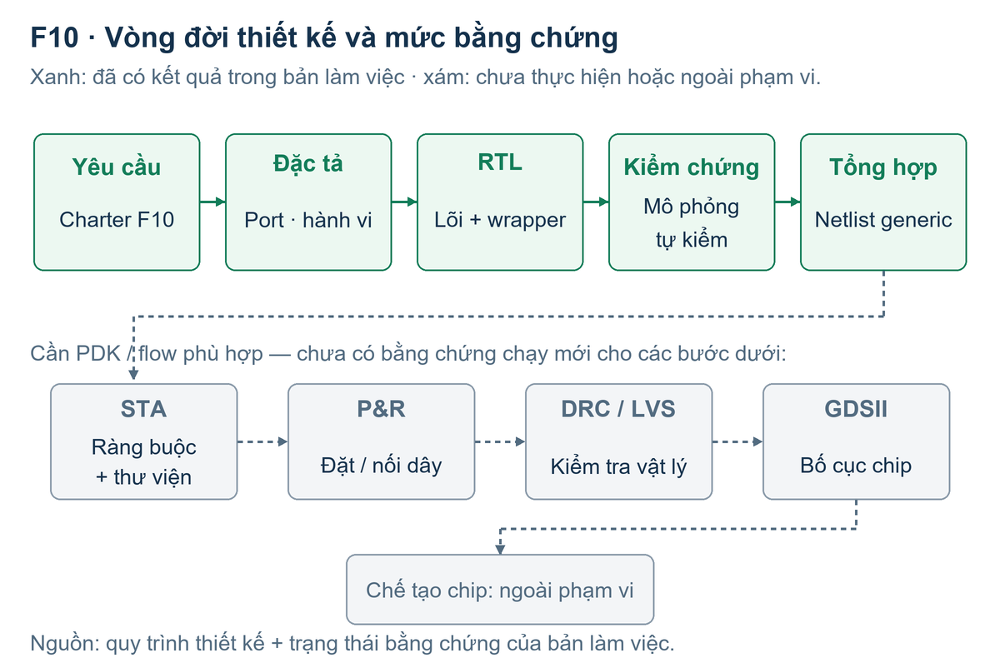

# F10 - Bản báo cáo làm việc

## BÁO CÁO BÀI KIỂM TRA SỐ 2

F10 FSM bắt tay bốn pha req/ack

TRƯỜNG ĐẠI HỌC PHENIKAA Nhập môn Thiết kế Vi mạch Tích hợp - EEE703128

| Thông tin | Nội dung |
| --- | --- |
| Sinh viên | Lê Chí Hoàng Cường |
| Mã số sinh viên | 24101280 |
| Lớp | Nhập môn thiết kế vi mạch tích hợp-1-1-26(N01) |
| Giảng viên hướng dẫn | Đinh Văn Nam |
| Ngày cập nhật | 20/10/2026 |
| Repo / commit / CI | Mã chính local: 4750b08. Chưa công bố GitHub hoặc có CI run; phải bổ sung trước khi nộp. |

<b>Trạng thái hồ sơ:</b> bản làm việc có số liệu mô phỏng và tổng hợp generic chạy trên Ubuntu WSL của người học, với hỗ trợ của Codex. Chưa phải bản nộp hoàn tất Cổng A. Không ký cam kết “toàn bộ số liệu từ GitHub CI” khi CI chưa chạy.

Kết quả hiện có: lõi 1.035 ca, wrapper 11 ca đều PASS; tổng hợp generic có 22 flip-flop, không suy ra latch. Chưa có số liệu PDK, STA, công suất hoặc layout của lần chạy mới.

Bố cục: 1. Đặc tả (tr.2-3); 2. RTL (tr.4); 3. Kiểm chứng (tr.5-8); 4. Tổng hợp (tr.9); 5. Thời gian (tr.10); 6-7. Công suất, vật lý và layout (tr.11); 8. Phân tích riêng (tr.12); 9. Kết luận (tr.13); tái lập và nguồn (tr.14).

## 1. Đặt vấn đề và đặc tả

Khi một khối cần yêu cầu khối khác xử lý, hai bên phải thống nhất thời điểm bắt đầu và kết thúc. F10 thực hiện bên phát yêu cầu: đưa req lên, chờ ack lên, hạ req, rồi chờ ack hạ. Chỉ sau bước cuối mới phát xung done.

Hình 1. Vị trí của F10 trong hệ thống. Đối tác đáp ứng được mô hình hóa trong testbench.

Phân loại và phạm vi

Đây là mạch số tuần tự: kết quả phụ thuộc đầu vào hiện tại và trạng thái đã lưu. Đếm chờ, giữ cấu hình và chuyển trạng thái đều dùng flip-flop. Logic so sánh, cộng và giải mã đầu ra là logic tổ hợp. Không có khối analog hoặc mixed-signal trong RTL này.

Thiết kế chỉ điều khiển giao thức, không truyền payload. Clock được chia sẻ; ack và start đồng bộ. Đối tác hợp lệ giữ ACK cao đến khi quan sát req thấp và chỉ xác nhận yêu cầu mới sau req mới. Đồng bộ clock tự nó chưa bảo đảm đúng thứ tự bốn pha. CDC, metastability, giao thức hai pha và truyền nhiều byte ngoài phạm vi.

Cách hiểu giao diện: lõi là requester, responder là đối tác bên ngoài. Nếu giảng viên muốn cả hai bên là RTL triển khai riêng, phải chốt lại phạm vi; hồ sơ này không nhận là đã triển khai một cặp requester/responder độc lập. [S1, S2]

## 1.1. Giao diện, reset và các giả định

| Tín hiệu / chân | Rộng, chiều | Mức / ý nghĩa |
| --- | --- | --- |
| clk | 1, vào | Cạnh lên cập nhật các thanh ghi |
| rst_n | 1, vào | Tích cực 0, reset đồng bộ tại cạnh lên |
| ena | 1, vào | Cho nhận start mới; không đóng băng giao dịch đang chạy |
| ui_in[7:0] | 8, vào | N không dấu 0..255; chốt khi nhận start |
| uio_in[0] | 1, vào | ack tích cực 1; theo charter |
| uio_in[1] | 1, vào | start tích cực 1; ánh xạ bổ sung được đề xuất |
| uo_out[0] | 1, ra | req tích cực 1 |
| uo_out[2:1] | 2, ra | [1]=done, [2]=timeout; xung một chu kỳ |
| uo_out[6:3] | 4, ra | state: 0,1,2,3 |
| uo_out[7] | 1, ra | Cố định 0 |
| uio_out / uio_oe | 8 / 8, ra | Đều 0; tất cả chân uio ở chế độ vào |

Start chỉ được nhận ở IDLE khi start=1 và ack=0. Start trong lúc bận không được xếp hàng. Start giữ mức 1 có thể khởi động tiếp khi trở về IDLE. Với wrapper, start nội bộ bằng ena AND uio_in[1].

ACK cũ đang cao khiến start bị từ chối. Thay N trong lúc bận không đổi thời hạn đã chốt. ACK đúng hạn thắng timeout; reset tại cạnh lên có ưu tiên cao nhất.

<b>Điểm cần giảng viên xem xét:</b> charter chưa gán chân start. Dùng uio_in[1] là phương án tích hợp từ chân trống, không phải phê duyệt đã có. Các chân charter giữ nguyên; dùng 10 bit vào và 7 bit ra, nằm trong ngân sách 24 chân.

## 2. Thiết kế RTL và quyết định kiến trúc

Hình 2. Cấu trúc RTL thực: FSM, ngưỡng đã chốt, bộ đếm chờ và giải mã đầu ra.

| Trạng thái | Điều kiện tại cạnh lên | Hành động / trạng thái tiếp |
| --- | --- | --- |
| IDLE (0) | start và ack=0 | Chốt N; count=0; sang REQ_HIGH |
| REQ_HIGH (1) | ack=1 / hết hạn | Sang ACK_HIGH / timeout rồi IDLE |
| ACK_HIGH (2) | Luôn luôn | Giữ đủ một chu kỳ; sang WAIT_ACK_LOW |
| WAIT_ACK_LOW (3) | ack=0 / hết hạn | done / timeout; trở về IDLE |

req là ngõ ra Moore, bằng 1 ở trạng thái 1 hoặc 2. done và timeout là hai ngõ ra được đăng ký, mặc định xóa ở mỗi cạnh lên. Bộ đếm được xóa trước mỗi pha chờ; hai pha có hai ngân sách N riêng.

Bốn pha là bốn cạnh tín hiệu, không bắt buộc mọi cách thiết kế phải có bốn trạng thái. Phiên bản nguồn dùng enum 4 bit và xuất mã state ra chân; không thay mã hóa để làm đẹp số cell. Lõi nguồn giữ nguyên, wrapper cũ buộc clock/reset/start bằng hằng được sửa ở lớp tích hợp. [S2]

## 3. Kiểm chứng chức năng: kế hoạch và kết quả

Expected được tính bởi mô hình đếm số chu kỳ còn lại, không đọc state nội bộ để đoán đáp án. Stimulus đổi ở cạnh xuống; model lấy mẫu ở cạnh lên, checker đọc sau 1 ns để chờ phép gán nonblocking hoàn tất. Clock mô phỏng là 10 ns, độ chính xác 1 ps.

| Nhóm ca | Mục đích / kỳ vọng | Kết quả |
| --- | --- | --- |
| Bình thường | Đủ bốn cạnh; done một chu kỳ | PASS |
| Đáp ứng chậm | ACK lên/xuống trễ nhưng trong N | PASS |
| Không có ACK, N=4 | Timeout ở cạnh chờ thứ 4; không done | PASS |
| Hai lần liên tiếp | Hai done riêng, nạp lại N=2 rồi N=9 | PASS |
| ACK mắc cao / ACK cũ | Timeout pha về; không nhận start cũ | PASS |
| Start bận / đổi N bận | Không chen giao dịch hoặc nạp lại N | PASS |
| Reset trong các trạng thái | Chỉ reset tại cạnh lên | PASS |
| 4 nhóm × 256 N | Hai timeout, hai ưu tiên ở deadline | 1.024 PASS |
| Stress seed F1002026 | 4.096 chu kỳ, có 16 reset | PASS |

Lõi: <b>1.035 ca, 138.571 chu kỳ được kiểm, 1.665.218 phép check, 0 lỗi</b>. Compile và simulator đều thoát 0. Log có câu ALL TESTS PASSED; CSV có 1.035 ID riêng biệt. Wrapper: <b>11 ca, 708 check, 0 lỗi</b>, gồm nối chân, ena, reset và đủ 8 bit cấu hình.

Nguồn: current_core/simulation.log, case_results.csv, f10_core_selfcheck.vcd; wrapper/summary.json và wrapper_cases.csv. “Check” là phép so sánh của checker, không phải 1.665.218 kịch bản độc lập. [E1, E2]

## 3.1. Waveform bốn pha của lần chạy thật

Hình 3. Vẽ lại từ các chuyển mức trong VCD mới, không phải hình minh họa suy đoán.

| Pha | Cạnh thực trong VCD | Ý nghĩa |
| --- | --- | --- |
| 1 | req lên tại 45 ns | Nhận start ở cạnh clock, phát yêu cầu |
| 2 | ack lên tại 50 ns | Đối tác đồng ý; FSM lấy mẫu ở 55 ns |
| 3 | req xuống tại 65 ns | Requester kết thúc mức yêu cầu |
| 4 | ack xuống tại 70 ns | Đối tác trả về trạng thái nghỉ |

done lên tại 75 ns, sau khi FSM lấy mẫu ack=0; xuống tại 85 ns. Khoảng req↑ đến done↑ là 30 ns = 3 chu kỳ trong ca này. ACK đổi ở cạnh xuống trong TB nên cạnh vật lý trong VCD và cạnh FSM nhận ACK cách nhau 5 ns.

Đọc hình phải phân biệt: 50 ns là cạnh ACK được kích thích, 55 ns là lúc FSM nhận ACK. Gọi 55 ns là “ACK lên trong VCD” sẽ sai. state=2 giữ req cao một chu kỳ rồi mới hạ tại 65 ns. [E1]

## 3.2. Timeout và hai lần bắt tay liên tiếp

Hình 4. N=4, ACK luôn thấp: req lên 195 ns; timeout lên tại 235 ns.

Bốn cạnh chờ là 205, 215, 225, 235 ns. Không tính cạnh nhận start 195 ns vào bốn cạnh chờ. Timeout kéo dài đến 245 ns và done không bật. Lỗi so sánh lệch một đơn vị sẽ bị ca này bắt.

Hình 5. done thứ nhất tại 365 ns; req mới tại 375 ns; done thứ hai tại 455 ns.

“Liên tiếp” ở đây là nhận start mới ở cạnh lên đầu tiên sau khi giao dịch trước hoàn tất. Không có hai giao dịch chồng nhau. N được đổi từ 2 sang 9 và chốt lại cho giao dịch thứ hai. [E1]

## 3.3. Ca bổ sung, ca biên và thử phá mạch

| Ca bổ sung | Lỗi cần bắt mà happy path bỏ sót |
| --- | --- |
| ACK giữ cao sau khi req hạ | Bỏ quên timeout ở pha trả về; treo mãi dù pha đầu đúng |
| N=0,1,255 ở cả hai pha | Tràn/cắt bit, hiểu N=0 thành 256, deadline sai một chu kỳ |
| ACK đúng cạnh hết hạn | Đảo ưu tiên if làm giao dịch hợp lệ bị timeout |
| Đổi N trong lúc bận | Không chốt cấu hình; thời hạn đổi theo input |
| Start khi bận và ACK cũ | Giao dịch chen ngang hoặc tự xếp hàng không đặc tả |
| Reset giữa hai cạnh lên | Nhầm reset đồng bộ thành bất đồng bộ |

Với N=0, cạnh chờ đầu tiên kiểm ACK trước rồi mới kiểm hết hạn. Do đó ACK hợp lệ ngay cạnh này vẫn thắng. Đây không phải timeout tổ hợp tức thời tại cạnh start.

Phép thử phá mạch trên bản sao riêng

| Lỗi cố tình đưa vào | Compile / chạy | Kết quả checker |
| --- | --- | --- |
| Deadline lệch một chu kỳ | 0 / 1 | FAIL đầu: TC03_NO_ACK |
| Đổi ưu tiên ACK tại deadline | 0 / 1 | FAIL: SW_LOW_TIMEOUT_N000 |
| Nạp lại N khi đang bận | 0 / 1 | FAIL đầu: TC07_BUSY_START |

Ba bản sao lỗi đều bị phát hiện; RTL triển khai không chứa các mutation này. Đây là ba thí nghiệm về sức bắt lỗi của TB, không phải chứng minh mọi lỗi đều bị bắt. Log FAIL có chủ ý được đặt riêng. [E3]

Sweep phủ mọi N cho bốn kịch bản đã định nghĩa, không phủ mọi chuỗi input. Stress PASS nghĩa RTL khớp model, không chứng minh đối tác tuân thủ giao thức. Chẩn đoán riêng đo ACK hạ 5280 ns trước req hạ 5285 ns, nhưng done vẫn lên 5295 ns: đây là đối tác ngoài contract, không phải PASS bốn pha. Chưa formal, fault injection, sau mapping hoặc metastability; X/Z ngoài contract. [E5]

## 4. Kết quả tổng hợp và đối chiếu thanh ghi

Yosys 0.52 thực hiện hierarchy, synth và flatten tới cell generic. Đây chưa phải ánh xạ standard cell Sky130. Không dùng số 106 cell, diện tích hoặc slack có sẵn trong gói nguồn làm kết quả mới.

| Chỉ số | Lõi | Top Tiny Tapeout |
| --- | --- | --- |
| Tổng cell generic | 209 | 210 |
| Flip-flop | 22 | 22 |
| Logic tổ hợp | 187 | 188 |
| Latch | 0 | 0 |
| Area / utilization | Chưa có PDK | Chưa có PDK |

Giải thích chính xác 22 flip-flop

| Net thanh ghi ở Q của FF | Số bit | Loại generic |
| --- | --- | --- |
| count_q[7:0] | 8 | $_SDFF_PN0_ |
| done, timeout | 1 + 1 | $_SDFF_PN0_ |
| timeout_q[7:0] | 8 | $_SDFFE_PN0P_ |
| state_q[3:0] / state[3:0] | 4 | $_SDFFE_PN0P_ |
| Tổng | 22 | 10 SDFF + 12 SDFFE |

Kết quả được đối chiếu chân Q của cell trong design.json với netnames, không suy từ tên module “4 trạng thái”. Lần tổng hợp này giữ 4 bit trạng thái quan sát được. Bốn trạng thái về mặt thông tin chỉ cần 2 bit, nhưng không đồng nghĩa mọi RTL/Yosys run đều cho đúng 2 FF trạng thái.

Charter gợi ý 18-19 bit cho state+counter+giữ N, chưa cộng hai output đã đăng ký. Đếm trực tiếp khai báo của RTL này cho 4+8+8+1+1=22. Đây là đối chiếu hồi cứu; không ghi giả thành dự đoán đã lập trước khi chạy. OR=56 và ANDNOT=52 là hai nhóm nhiều cell nhất, chưa thể kết luận nhóm lớn nhất về diện tích. [E4]

## 5. Thời gian: latency giao thức và STA

Clock 10 ns trong testbench xác định lịch kích thích và số chu kỳ hành vi. Nó không đo độ trễ cổng, không phải kết quả STA và không chứng minh mạch vật lý hoạt động ở 100 MHz.

| Đại lượng | Dữ liệu hiện có | Cách hiểu |
| --- | --- | --- |
| req↑ đến done↑ ca bình thường | 45 đến 75 ns = 3T | Latency của kịch bản mô phỏng |
| Timeout N=4, không ACK | 195 đến 235 ns = 4T | Ngân sách pha chờ đầu |
| Worst setup / hold slack | Chưa có | Cần thư viện và SDC đúng |
| Đường tới hạn / CTS skew | Chưa có | Không suy từ số cell hoặc VCD |
| Chu kỳ cấu hình physical | Xem config trong repo | Là giả định cần kiểm bằng STA |

Giới hạn số chu kỳ trong model

Mỗi pha chờ có nhiều nhất W=max(1,N) cạnh lấy mẫu, ACK đúng hạn được ưu tiên. Giữa hai pha là một chu kỳ ACK_HIGH. Từ accepted start đến done/timeout, với input đồng bộ hợp lệ, giới hạn bảo thủ là <b>2W+1 chu kỳ</b>. N=255 cho 511 chu kỳ; N=0 cho 3 chu kỳ. Watchdog 512 chu kỳ không cắt giao dịch hợp lệ.

Chẩn đoán tách riêng xác nhận: N=0 đo 35-65 ns (3T); N=1 đo 85-115 ns (3T); N=255 đo 135-5245 ns (511T). Cả hai ACK đều được lấy mẫu đúng deadline; 1.607 check, 0 mismatch cho 3 ca hợp lệ và 1 quan sát đối tác sai giao thức. Không cộng bốn thí nghiệm này vào 1.035 ca gốc. [E5]

Khi có STA, cần ghi setup slack và hold slack riêng, endpoint/startpoint, corner PVT, thư viện, input/output delay và clock uncertainty. Chỉ xem slack setup dương là đạt ở ràng buộc đó; hold âm không được sửa bằng việc hạ tần số clock.

Giả thuyết cần kiểm: đường cộng count và so sánh deadline có thể là đường sâu. Đây chưa phải đường tới hạn đo được. Không tự điền số tầng logic, tần số tối đa hoặc slack từ giả thuyết này. Theo hướng dẫn Canvas/charter, báo cáo không khẳng định “chạy được ở X MHz”. [S1, S3]

## 6-7. Công suất, kiểm tra vật lý và layout

| Hạng mục | Trạng thái / điều kiện còn thiếu |
| --- | --- |
| Công suất động, rò, tổng | Chưa có số đo; cần thư viện, corner và hoạt động chuyển mức |
| DRC / LVS | Chưa chạy; không điền “0 vi phạm” |
| CTS, routing, wirelength | Chưa chạy; không có skew hoặc buffer clock mới |
| Layout 2D / 3D / GDS | Chưa có artifact của lần chạy mới |

Hình 6. Mức bằng chứng hiện có. Đây là sơ đồ quy trình, không phải ảnh layout.

Môi trường WSL có Icarus, Yosys và Verilator; chưa có bộ flow/PDK vật lý được xác nhận dùng được. Kiểm tra môi trường chỉ là preflight, không phải một lần LibreLane chạy rồi thất bại. Do đó chưa dùng nó thay nhật ký lỗi flow theo M3. CI phải chạy thực trước khi chốt báo cáo.

DRC kiểm quy tắc hình học; LVS so sánh kết nối layout với netlist tham chiếu. <b>DRC sạch không có nghĩa mạch đúng chức năng.</b> Ngay cả LVS khớp cũng không chứng minh netlist đã thực hiện đúng đặc tả. Khi chưa có layout, không bịa hàng cell, lớp kim loại hoặc ảnh 3D. [S1, S3]

## 8. Trả lời câu phân tích riêng F10

<i>Trích yêu cầu:</i> “Vẽ giản đồ thời gian bốn pha từ waveform mô phỏng của chính mình và chú thích từng pha; đây là phần trọng tâm của báo cáo đề này.” [S1]

Hình 3 đáp ứng yêu cầu này: req↑45, ack↑50, req↓65, ack↓70 ns; done↑75 ns. Cửa sổ TC01_NORMAL là 37-87 ns trong CSV. Các chuyển mức được lấy từ VCD, không suy từ sơ đồ trạng thái bên dưới. [E1]

Hình 7. Sơ đồ trạng thái đúng theo RTL; nhánh timeout có thể hủy giao dịch trước đủ bốn pha.

<b>Timer:</b> count_q rộng 8 bit. N được nạp từ ui_in[7:0] và giữ trong timeout_q. N>0 so với N-1; N=4 kiểm count=0,1,2,3 ở bốn cạnh chờ. N=0 có nhánh riêng.

<b>Bỏ timeout:</b> ACK không lên làm kẹt REQ_HIGH; ACK không xuống làm kẹt WAIT_ACK_LOW. Giao dịch mới không được nhận. Timeout đưa requester về IDLE, không sửa đối tác.

<b>Safety:</b> checker kiểm state, req, xung kết quả và ưu tiên. <b>Liveness:</b> không có reset can thiệp, giao dịch được nhận kết thúc trong 2×max(1,N)+1 chu kỳ. Đây là contract và bằng chứng mô phỏng có giới hạn, chưa phải formal proof.

## 9. Kết luận, giới hạn và truy vết yêu cầu

| Yêu cầu | Bằng chứng hiện có | Trạng thái |
| --- | --- | --- |
| Bối cảnh + phân loại | Tr.2, Hình 1 | Có |
| Giao diện + kiến trúc | Tr.3-4; RTL; Hình 2 | Có; start là đề xuất |
| 4 ca bắt buộc + ≥2 ca thêm | Log/CSV; tr.5-8 | PASS cục bộ |
| Câu phân tích riêng | Hình 3, mốc VCD; tr.12 | Có |
| Mô phỏng + thử phá mạch | E1-E3, exit status | Có |
| Đọc tổng hợp | E4: 22 FF, 0 latch | Generic, chưa PDK |
| Repo + lịch sử + CI run | Chưa có URL/run | Cổng A còn mở |
| Physical hoặc lỗi flow thật | Chưa khởi chạy LibreLane | Còn thiếu |
| PDF 8-15 trang | Bản chính 14 trang | Bản làm việc |

Kết luận có điều kiện

Với Icarus 12.0, input đồng bộ và contract đã nêu, RTL khớp mô hình tham chiếu ở các ca đã thực thi; ba lỗi cố tình đều bị phát hiện. Với Yosys 0.52 và script generic hiện tại, thiết kế hiện thực được thành flip-flop và logic, không suy ra latch.

Kết quả này chưa chứng minh timing vật lý, công suất, DRC/LVS, hoạt động trên silicon hoặc mọi chuỗi input có thể xảy ra. Không tự chấm mức Giỏi khi Cổng A và phần physical còn thiếu. Để hoàn tất M3-M5: công bố repo có lịch sử thật, chạy CI, giữ artifacts hoặc lỗi flow thật và cập nhật đúng commit/run trong báo cáo.

Các lỗi tài liệu nguồn đã xử lý: wrapper buộc clock/reset/start bằng hằng; README nêu thư mục physical không có trong ZIP; bound 257 chu kỳ không đủ cho hai pha chờ; các con số area/slack cũ không có artifact tái lập. Việc sửa được ghi riêng, không thay nguồn tham chiếu.

## Thông tin tái lập, nguồn và trách nhiệm

| Thông tin | Giá trị / cách đối chiếu |
| --- | --- |
| Môi trường | Ubuntu WSL trên Windows; chạy cục bộ 19-20/10/2026 |
| Công cụ | Icarus 12.0; Yosys 0.52; Verilator 5.032 |
| Thời gian mô phỏng | timescale 1ns/1ps; clock 10 ns; seed F1002026 |
| Lõi nguồn SHA-256 | 10cca64461908d5cbe1da1d36be07633c613b92f1c2daeff7fd2ba414cccdfe4 |
| VCD SHA-256 | 3678ae4b0a8b0a4f1ec920176603d8aa979dffe1e7c93a7bb44db5fcd23a83d5 |
| LibreLane / PDK / CI | Chưa chạy; bổ sung phiên bản, commit và URL thực sau CI |

Tái lập: dùng README trong delivery/F10_24101280, chạy riêng top TB lõi và TB wrapper; đọc log, summary, CSV, exit code và hash nguồn. Chạy generic synth riêng; không đưa TB vào synthesis. Phụ lục mã chứa RTL và TB đầy đủ.

Nguồn tham chiếu

[S1] Charter F10, p_charter_F10.html (bản người học cung cấp): mục 4-6, 9-12. [S2] F10_FSM_bat_tay_bon_pha_req_ack.zip, SHA-256 c2fb74d93be43da5bb6b0c4aff0458ef27d332fbdd611c7b7d6413288764ade3. [S3] Canvas course 30065: hướng dẫn chung file 4677304, mẫu CI file 4677309; bản chép văn bản nhìn thấy được lưu ở reference/canvas/. [S4] MAU_BAO_CAO_B2 và Lab A+B trong gói EEE703128_Guide4Studentsv2.4.

[E1] work/F10/05_VERIFICATION/runs/current_core/. [E2] .../runs/wrapper/. [E3] .../current_core/mutation_smoke/results.csv. [E4] work/F10/06_GDSII/generic/{core,wrapper,lint}/. [E5] work/F10/05_VERIFICATION/diagnostics/contract_bounds/. Bản sao và lần chạy portable: xem docs/EVIDENCE_INDEX.md trong bộ mã.

Hỗ trợ AI và phần người học phải xác nhận

Codex hỗ trợ đọc yêu cầu, sửa wrapper, viết checker/mô hình tham chiếu, chạy công cụ trên máy người học, đối chiếu netlist, dựng hình và soạn bản làm việc này. Lõi được giữ nguyên từ gói nguồn. Người học phải chạy lại, kiểm tra số liệu, tự giải thích và sửa diễn đạt thành hiểu biết của mình trước khi nộp; không ký cam kết tác giả hoặc nguồn CI sai sự thật.
